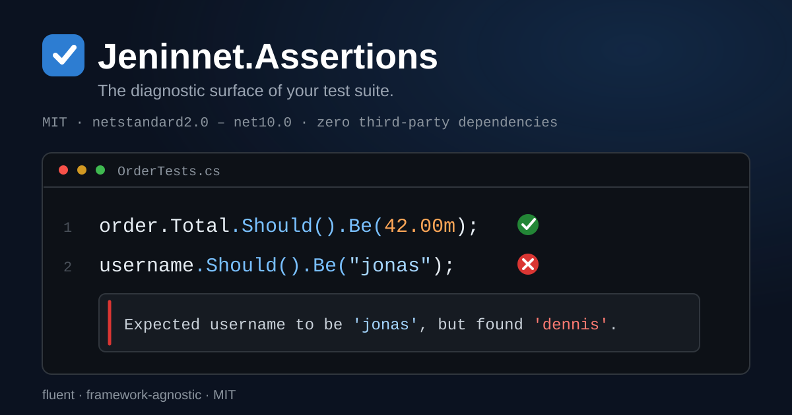

# Jeninnet.Assertions




[](https://github.com/TarekNajem04/Jeninnet.Assertions/stargazers)
[](https://github.com/TarekNajem04/Jeninnet.Assertions/blob/main/LICENSE)


[](https://www.nuget.org/packages/Jeninnet.Assertions/)

A fluent, framework-agnostic assertion library for .NET, providing expressive validation for objects, strings, collections, numerics, dates, exceptions, asynchronous operations, reflection metadata, streams, XML, JSON, events, and IO test infrastructure.

This repository contains the **standalone** `Jeninnet.Assertions` package. It has been separated from the `Jeninnet.Localization` repository so it can build, test, and publish independently.

Targets: `netstandard2.0`, `net6.0`, `net8.0`, `net10.0`.

## License and independence

This library is **MIT licensed** and depends on no test framework: nothing from MSTest, xUnit, or NUnit
is required to use it, so it can be adopted inside any test project, commercial or not. It is designed
in the spirit of existing assertion libraries such as FluentAssertions and others, while keeping its own
identity, vocabulary, and implementation. The assertion list below is the authoritative list of what it
provides, and the book carries an explicit migration map
([chapter 10](docs/en/10-ecosystem.md) / [الفصل ١٠](docs/ar/10-ecosystem.md)).

## Reliability (generated badges)

Every badge below is **derived from tests**, never hand-written. One command rebuilds all four from the
current source — `.\scripts\badges\generate.ps1` builds the library, runs the badge-gate tests, and renders
`badges/*.svg`:

   

| Badge | What it guarantees | Backing test |
|---|---|---|
| API stability | The committed public-API baseline (`tests/.../ApiBaselines`) matches the built assemblies exactly — any accidental public addition, removal, or signature change fails the suite. | `PublicApiSurface_MatchesCommittedBaseline` |
| Third-party deps | The library has zero third-party runtime dependencies (only BCL shims on old TFMs) and references none of MSTest, xUnit, or NUnit. | `IndependenceTests` |
| Target frameworks | The badge TFMs come straight from the library csproj `TargetFrameworks`: netstandard2.0 · net6.0 · net8.0 · net10.0, all four built in Release. | `dotnet build … -c Release` |
| Performance invariant | Hot verbs allocate nothing for message formatting on the success path (56–128 B on .NET 10 Release) while failures stay diagnostic (1.1–52.6 KB), so a formatted success path cannot slip in unmeasured. | `PerformanceInvariantTests` |

## Features

- **Framework-agnostic** — no dependency on MSTest, xUnit, or NUnit. Works with any .NET test framework.
- **Fluent API** — intuitive `Should().*` chain starting from any value, with `.And` chaining across assertions.
- **Named subjects & reasons** — failure messages name the captured subject and support `because` clauses.
- **Assertion scopes** — batch multiple failures into one report via `using (new AssertionScope())`, with
  pluggable failure routing (`AssertionScope(IAssertionStrategy)`) and a `Given(selector)` chain
  (`ForCondition`/`Given`/`FailWith`) for conditional multi-step checks.
- **Localization as a product** — `AssertionCulture.Current` selects the failure-message language (English
  neutral, Arabic complete, French reference satellite); a public `AssertionCulture.GetMessage`/`FormatMessage`
  reader exposes localized templates, and new languages are drop-in `.resx` files with per-key English fallback.
- **Deterministic clocks** — `AssertionClock.Current` injects an `IClock` (default `SystemClock`) into every
  time-relative verb (`BeWithin`, `BeLessThan`, `BeMoreThan`, `BeAtLeast`), so boundary tests are exact and
  sleep-free; a ready-made `ManualClock` covers the common case (advance/set, thread-safe) and
  `TimeProviderClock` (net8+) bridges any `TimeProvider`, including existing fakes; isolated per async flow
  like scopes and culture.
- **Typo-aware diagnostics** — failed lookups suggest the nearest existing name (`Did you mean 'name'?`),
  ordered by edit distance and capped at three, across dictionary keys, JSON properties and paths, and
  string collections.
- **One-line test isolation** — `using(AssertionIsolation.Isolate())` snapshots and restores culture, clock,
  the global formatter registry, and the ambient equivalency template, so settings changed inside a test never
  leak into the next; restoration survives exceptions and nested scopes.
- **Soft assertions** — collect failures across many assertions and report them as a single exception via
  `new SoftAssertions().Collect()` … `ThenReport()`, with no mandatory `using` block; `Failures` exposes the
  structured breakdown (expression, category, actual/expected) and `ToReportJson()` serializes it for CI
  attachments or dry runs.
- **Validators** — `AssertionResult.Create(...)`/`CreateAsync(...)` run the same `Should()` verbs in
  production code without throwing: they collect every failure into a structured result (`IsSuccess`,
  `Failures`, `ToReportJson()`) that any HTTP handler or validation layer can consume; `ThrowIfFailed()`
  turns the result back into one aggregate assertion failure. For a single object-graph comparison,
  `EquivalencyEvaluation.Evaluate` returns the verdict directly — same engine and difference texts as
  `BeEquivalentTo`, with structured `Path`/`Expected`/`Actual` differences and a JSON report.
- **Eventual-consistency native** — `SucceedWithin()`/`EventuallySatisfy()` poll until a condition holds
  (never `Thread.Sleep`), report the last value and error on failure, and accept a `PollingBackoff`
  (`Constant` or curved `Exponential`) so long waits back off instead of hammering the subject.
- **Fully asynchronous** — `ThrowAsync`, `NotThrowAsync`, timeouts, plus synchronous `Throw`, `NotThrow`.
- **Descriptive failures** — clear messages with invariant formatting, customizable via scoped or global value formatters.
  Long or multiline strings append an invariant unified diff (`Be`, `BeEquivalentTo`) so the exact change is visible.
- **Measured performance** — a tested invariant guarantees hot verbs (`Be`, `BeTrue`, `Contain`, `HaveCount`)
  allocate nothing for message formatting on the success path (56–128 B on .NET 10 Release) while failures stay
  diagnostic (1.1–52.6 KB), so rich messages never tax green tests.
- **Extensible** — custom formatters, global configuration, assembly-level engine initializers,
  custom equivalency steps/plans/rules, and marker discovery for extension assemblies.
- **IO test infrastructure** — isolated test directories and inaccessible-directory simulation.

## Available Assertions

Expand any group to see its verbs; every backticked identifier is verified against the public API by
`scripts/docs/check-readme-claims.ps1`. All groups are collapsed by default.

<details>
<summary><strong>bool / bool?</strong> · Should()</summary>

- `BeTrue`, `BeFalse`, `NotBe`, `Imply`, `BeNull`, `NotBeNull`

</details>

<details>
<summary><strong>object</strong> · Should()</summary>

- Identity and shape: `Be`, `NotBe`, `BeSameAs`, `BeOfType`, `BeAssignableTo`, `Match`, `BeOneOf`
- Graphs: `BeEquivalentTo` / `NotBeEquivalentTo` (object graphs)
- Aggregation and custom equality: `SatisfyAllConditions` (direct extension, aggregates failures), custom `IEqualityComparer<T>` overloads
- Serialization round trips: `BeXmlSerializable` / `BeJsonSerializable` / `BeDataContractSerializable`

</details>

<details>
<summary><strong>equivalency options</strong> · BeEquivalentTo(..., o =&gt; ...)</summary>

- Member selection: `Excluding` / `Including` by path, name (`ExcludingMembersNamed`), value type, or predicate
- Visibility: `IncludingProperties` / `Fields` / `InternalProperties` / `InternalFields` / `AllDeclaredProperties` / `AllRuntimeProperties`, `ExcludingProperties` / `ExcludingFields` / `ExcludingExplicitlyImplementedProperties`
- Browsability and missing members: `ExcludingNonBrowsableMembers`, `IgnoringNonBrowsableMembersOnSubject`, `ExcludingMissingMembers` / `ThrowingOnMissingMembers`
- Mapping and nesting: `WithMapping` (paths, expressions, type-scoped), `For(...)` nested-collection builder
- Membership and ordering: `ComparingByValue`, `ComparingByMembers`, `WithStrictOrdering`, per-path `WithStrictOrderingFor` / `WithoutStrictOrderingFor`, `Using*Rule` + `Without*Rules`
- Typing and conversion: `WithStrictTyping[For]` / `WithoutStrictTyping[For]`, `WithAutoConversion[For]` / `WithoutAutoConversion[For]`, `PreferringRuntime/Declared/DefaultMemberTypes`
- Enums, records, null-as-empty: enums by value/name, records by value/members, null-as-empty (strings, collections)
- Cycles and depth: `AllowingInfiniteRecursion` / `IgnoringCyclicReferences`, `WithoutRecursing` / `IncludingNestedObjects`
- Graph strings and tolerances: `IgnoringCase`, whitespace, newlines, JSON key casing; `WithDateTimeTolerance[For]` (instants), `WithNumericTolerance[For]` (absolute epsilon)
- Extensibility: `IEquivalencyStep` / `EquivalencyStep` + `EquivalencyPlan`, per-assertion `Using` or global `EquivalencyDefaults.Plan`
- Value checks and shape: `Value.ThatMatches` / `ThatSatisfies`, `AsCollection()` (re-type as enumerable, element rules apply to every item), `IncludingFullStringsInDifference`
- Diagnostics and ambient overrides: `WithTracing` / `ITraceWriter`, `WithFullDump`, `With configuration:` block, `Modify` / `CloneDefaults` / `ResetToDefaults`

</details>

<details>
<summary><strong>string</strong> · Should()</summary>

- Basics: `Be`, `BeEmpty`, `BeNullOrEmpty` / `NotBeNullOrEmpty`, `HaveLength`, casing
- Affixes and containment: `StartWith` / `EndWith`, `Contain` (+occurrence)
- Lines: `ContainLine` + `Which`, `HaveLineCount`
- Patterns: `Match`, `MatchRegex`
- Equivalency: `BeEquivalentTo`, `*EquivalentOf` (+options)

</details>

<details>
<summary><strong>Regex matches</strong> · Should() (net6.0+)</summary>

- `Succeed`, `HaveValue` (whole match), `HaveGroup` (by name or number; non-participating groups count as empty)
- `HaveGroupCount` (includes group 0); missing groups list the available names

</details>

<details>
<summary><strong>Collections</strong> · Should()</summary>

- Counts and emptiness: counts and bounds (+`NotHaveCount`, `NotHaveSameCount`), null-or-empty (`BeNullOrEmpty` / `NotBeNullOrEmpty`)
- Uniqueness and nulls: `OnlyContain`, `OnlyHaveUniqueItems`, `NotContainNulls`, projections (`OnlyHaveUniqueItems` / `NotContainNulls` key overloads)
- Inspectors: `SatisfyRespectively`, `AllSatisfy`, `Satisfy`
- Types: `AllBeOfType`, `AllBeAssignableTo`, `ContainItemsAssignableTo`
- Ordering: `ContainInOrder` / `NotContainInOrder`, `ContainInConsecutiveOrder` (+negative), ordering (+negatives, expression/`Func` overloads, `ThenBeIn` chains via `SubsequentOrderingAssertions<T>`)
- Position and neighbors: `HaveElementAt`, `HaveElementPreceding`, `HaveElementSucceeding`, `StartWith` / `EndWith` (single-item + element-predicate overloads)
- Sets: `BeSupersetOf`, `BeProperSubsetOf` / `SupersetOf`, +`NotBeSubsetOf`, `IntersectWith` / `NotIntersectWith`
- Equality: `Equal` / `NotEqual` / `BeEqualTo` / `NotBeEqualTo` (+element-predicate overloads)
- Equivalency: `BeEquivalentTo` / `NotBeEquivalentTo` / `AllBeEquivalentTo`, `ContainEquivalentOf` / `NotContainEquivalentOf`, counts (+predicate overload)
- Strings: `AllBe`, `ContainMatch` + `Which` / `NotContainMatch`

</details>

<details>
<summary><strong>Async sequences</strong> · Should() (net6.0+)</summary>

- `BeEmptyAsync` / `NotBeEmptyAsync`, `HaveCountAsync`
- `ContainAsync` / `NotContainAsync` (index diagnostics), `ContainInOrderAsync` (search-window diagnostics)
- `BeEquivalentToAsync` (multiset), `CompleteAsync` (full drain with `Which`)
- Every verb is cancellation-token-aware

</details>

<details>
<summary><strong>Dictionaries</strong> · Should()</summary>

- Lookups: `ContainKey(s)`, `ContainValue` (+`Which`), `ContainValues` (+`Which`), `Contain(key, value)`
- Counts: (+`NotHaveCount`, `NotHaveSameCount`, `HaveSameCount`)
- Negatives: `NotContain` (key/pair/pairs/key+value), `NotContainValue(s)`
- Equality: `Equal` / `NotEqual` / `BeEqualTo` / `NotBeEqualTo` (+pair-predicate overloads)
- Sets: `BeSubsetOf` / `NotBeSubsetOf`, `BeSupersetOf`, `BeProperSubsetOf` / `SupersetOf`
- Ordering: expression/`Func` overloads, `ThenBeIn` chains
- Equivalency

</details>

<details>
<summary><strong>Spans</strong> · Should() (AsAssertions() on netstandard2.0)</summary>

- Collection assertions on `Span` / `ReadOnlySpan` / `Memory` / `ReadOnlyMemory` (`Equal` / `BeEqualTo` / `NotBeEqualTo`, sets, ordering incl. `ThenBeIn` chains, counts, inspectors, `ContainEquivalentOf`)
- `Be(string)` for character spans

</details>

<details>
<summary><strong>Numerics</strong> · Should()</summary>

- `Be` / `NotBe` (chainable), comparisons, ranges
- Rank equality (`BeRankedEquallyTo` / `NotBeRankedEquallyTo`, `BeEquivalentTo`)
- Signs and special values: `BePositive` / `BeNegative`, `BeApproximately`, `BeNaN`
- `BeOneOf`, `Match` (+nullable with `HaveValue` / `NotHaveValue`)

</details>

<details>
<summary><strong>Dates, times, Guid, enums</strong> · Should()</summary>

- Ordering and windows: ordering, `BeCloseTo`, relative windows (`BeWithin` / `BeLessThan` / `BeMoreThan` / `BeAtLeast` / `BeExactly` + `Before` / `After`)
- Components: components (+negatives), `BeSameDateAs` (date part only), `TimeOnly` plural component aliases
- Kinds and offsets: `BeIn(DateTimeKind)`, offsets, exact instant+offset match
- `Guid`: `Guid` from text (+nullable with `HaveValue` / `NotHaveValue`)
- Enums: flags, defined checks (`BeDefined` / `NotBeDefined`, `BeOneOf`, `HaveValue` / `NotHaveValue`, `Match`, cross-type `HaveSameNameAs` / `ValueAs` + negatives)
- Sugar: `BeOneOf`, fluent date/time sugar

</details>

<details>
<summary><strong>Actions</strong> · Should() / FluentActions</summary>

- Entry: `FluentActions`, or `Should()` on the delegate
- Exceptions: `Throw`, `ThrowExactly`, `ThrowWithinAsync`, `NotThrow`, `NotThrowAfter`, `WithMessage` / `WithoutMessage`, `WithInnerException` / `WithInnerExceptionExactly`, `Where`, `WithParameterName`, `Which`
- Timing: `SucceedWithin`, delegate timing (`CompleteWithinAsync` / `NotCompleteWithinAsync`, `Which` result for `Func<Task<T>>`), `EventuallySatisfy` (+`PollingBackoff`)
- Allocations and concurrency: `AllocateAtMost`, `AllocateLessThan` (+async), `BeThreadSafeAsync` (simultaneous copies, aggregated failures, deadlock detection)
- Cancellation: `HonorCancellationAsync` / `CompleteDespiteCancellationAsync` on token-aware delegates
- Construction: `Invoking` / `Awaiting` / `Enumerating`, `As<TTo>`

</details>

<details>
<summary><strong>Tasks</strong> · Should() / ExecutionTime()</summary>

- `CompleteWithinAsync` (+`WithResultAsync`), `NotCompleteWithinAsync`
- Execution-time bounds: `BeLessThan[OrEqualTo]`, `BeGreaterThan[OrEqualTo]`, `BeCloseTo`, member-expression overload `ExecutionTimeOf`

</details>

<details>
<summary><strong>Types &amp; assemblies</strong> · Should() / AllTypes.From()</summary>

- Identity and hierarchy: identity (`Be`), interface implementation, base types, static/abstract/sealed, `Reference` / `NotReference`
- Members: constructors (+default), indexers, conversion operators, explicit members, return types, async/virtual
- Attributes and modifiers: attributes (+predicates), modifiers, `BeSignedWithPublicKey`
- Architecture selectors: kinds, namespaces, `ThatSatisfy`, unwrapping
- Member selectors: `Methods()` / `Properties()` / `Types()` with accessibility, modifier, attribute, return-type filters and offender-reporting assertions
- Member compatibility: method verbs `Be` / `NotBe(AccessModifier)`, decorated ±predicate, `NotBeAsync`, `NotBeVirtual`; property verbs decorated, `BeVirtual` / `NotBeVirtual`, `NotBeWritable`

</details>

<details>
<summary><strong>HTTP responses</strong> · Should() (net6.0+)</summary>

- `HaveStatusCode`, `BeSuccessful` (2xx), `HaveHeader` (response + content headers)

</details>

<details>
<summary><strong>Streams</strong> · Should()</summary>

- Capabilities (+negatives), read-only/write-only
- Length (+`NotHaveLength`), position (+`NotHavePosition`), buffer size (+`NotHaveBufferSize`)

</details>

<details>
<summary><strong>XML / JSON</strong> · Should()</summary>

- Elements, attributes, namespaces, values, inner text, occurrence constraints
- `Be` / `NotBe` (elements and attributes), deep equivalency (+`Which`), `NotBeEquivalentTo`
- JSON strings/numbers/booleans/arrays/UTC-local dates, `NotHaveProperty` (JSON)
- JSON paths: `HaveJsonPath` / `NotHaveJsonPath` (e.g. `$.users[0].name`)

</details>

<details>
<summary><strong>Events</strong> · Monitor() / Monitor&lt;T&gt;()</summary>

- `Raise` (+`Which`), `NotRaise`, `WithSender`, `WithArgs`
- `RaisePropertyChangeFor` / `NotRaisePropertyChangeFor`
- `IMonitor<T>` recordings, `EventMonitorOptions`

</details>

<details>
<summary><strong>IO</strong> · TestEnvironment</summary>

- Entry: `TestEnvironment`
- Isolated directories, files, trees, locks, inaccessible simulation

</details>

## Quick Start

```csharp
using Jeninnet.Assertions;

// Synchronous
Action act = () => { throw new InvalidOperationException("test"); };
act.Should().Throw<InvalidOperationException>().WithMessage("t*st");

Action ok = () => { };
ok.Should().NotThrow();

// Asynchronous
Func<Task> asyncAct = async () => { await Task.Delay(1); throw new TimeoutException(); };
await asyncAct.Should().ThrowAsync<TimeoutException>();

Func<Task> asyncOk = () => Task.CompletedTask;
await asyncOk.Should().NotThrowAsync();

// Chaining, because-clauses, and scopes
username.Should().Be("jonas", "the user was renamed");
"hello".Should().Contain("ell").And.Be("hello");

using (new AssertionScope()) {
    flag.Should().BeTrue();
    actual.Should().Be("expected");
}

// Object graphs, events, and architecture rules
order.Should().BeEquivalentTo(expected, o => o.Excluding(x => x.Id));
publisher.Monitor().Should().Raise("Changed").Which.Sender.Should().BeSameAs(publisher);
AllTypes.From(typeof(Order).Assembly).ThatDeriveFrom<Entity>().Should().BeSealed();
```

## Cancellation Semantics

Token-aware delegates are first-class: `HonorCancellationAsync()` hands over an already-canceled token and requires `OperationCanceledException` carrying that same token, while `CompleteDespiteCancellationAsync()` pins the inverse contract for critical sections that must finish. Separately, `NotThrowAsync` treats a canceled task as a failure outcome, not as success: a `TaskCanceledException`/`OperationCanceledException` surfaces as an assertion failure rather than being swallowed.

## Localization

Failure messages are English by default and can be switched at runtime — per async-flow, so parallel tests stay isolated:

```csharp
AssertionCulture.Current = new CultureInfo("ar");
flag.Should().BeTrue(); // المتوقع من flag أن يكون true، لكن وُجد false.
```

Arguments (values, counts, sizes) are always formatted invariantly, so messages stay byte-stable across machines; only the surrounding prose is translated. Unknown cultures fall back to English. Adding a language requires no code change: copy `src/.../Localization/Strings.resx` to `Strings.<culture>.resx`, translate the values, and the build produces the satellite assembly automatically. The `because` glue word and multi-failure scope headers are localized too.

## Snapshots

Text and JSON values can be pinned against committed baselines:

```csharp
order.Should().MatchSnapshot(); // order.verified.txt next to the test source
```

The snapshot name defaults to the subject expression (sanitized) and lives in `__snapshots__` beside the calling file unless a directory is passed. A missing baseline writes a `.received` file and fails with the received content inline — rename it to `.verified` to accept; a mismatch overwrites `.received` and shows a unified diff; a match deletes a stale `.received`. Nothing is ever auto-accepted; for bulk re-baselining, set `JENINNET_SNAPSHOT_UPDATE=1` for a single run to promote `.received` to `.verified` (opt-in only, exact value, reviewed in `git diff`). JSON serializes indented with LF endings on every machine; text compares byte-exact, so commit `*.verified.*` with `eol=lf` (e.g. in `.gitattributes`) to keep checkouts stable. Volatile content can be masked with explicit scrubbers: `MatchSnapshot("id", dir, o => o.Scrub(s => s.Replace("42", "<n>")))`. See [chapter 12](docs/en/12-snapshots.md) / [الفصل ١٢](docs/ar/12-snapshots.md).

## Playground

A runnable tour of the four ideas above — fluent style, the multi-failure report, snapshots, and the
deterministic clock — lives in `samples/Jeninnet.Assertions.Playground` (net10.0, no test runner):

```shell
dotnet run --project samples/Jeninnet.Assertions.Playground
```

It prints each demo's output, including a caught two-failure scope report, and exits non-zero only when
something behaves unexpectedly. The snapshot baseline (`__snapshots__/playground-report.verified.txt`) is
committed, so the first run is already green.

## Installation

```shell
dotnet add package Jeninnet.Assertions
```

## Book (from zero to complete)

The bilingual book in [`docs/`](docs/en/00-index.md) ([العربية](docs/ar/00-index.md)) teaches the
library chapter by chapter — values, collections, time, actions, equivalency, snapshots,
reflection, formats, events, IO, scopes, culture, and the MSTest/analyzer ecosystem — with the
Consumer template (`consumers/`) as its running example.

## Framework Independence

Production code references only the .NET base class library (plus `System.Text.Json` / `System.Xml.XDocument` on `netstandard2.0`). The package carries no test-framework dependency, so it can be used from MSTest, xUnit, NUnit, or any other test runner.

## MSTest Integration (optional)

The core package throws its own `AssertionFailedException`, which some MSTest reporters classify as an error rather than a test failure. If you want MSTest-native outcomes, reference the optional `Jeninnet.Assertions.MSTest` package (`net6.0+`) and wrap assertions explicitly — nothing is detected or rewritten automatically:

```csharp
MSTestAssertions.That(() => order.Should().Be("shipped"));
await MSTestAssertions.ThatAsync(() => action.Should().NotThrowAsync());
```

Failures surface as MSTest `AssertFailedException` with the message and inner exception preserved; all other exceptions propagate untouched. xUnit/NUnit adapters follow the same pattern on demand.

## Roslyn Analyzer (optional)

The optional `Jeninnet.Assertions.Analyzer` package suggests fluent assertions over convertible MSTest, xUnit, and NUnit calls, with code fixes (targets `netstandard2.0`, loads in every Roslyn host). Rule IDs use the `JNA` prefix (Jeninnet Assertions):

| ID | Severity | Converts |
|---|---|---|
| `JNA1001` | Info | `Assert.AreEqual`/`AreNotEqual`, xUnit `Assert.Equal`/`NotEqual`, `Assert.Contains`, NUnit `Is.EqualTo`/`Is.Not.EqualTo` → `Be` / `NotBe` / `Contain` (tolerance, comparer, and culture overloads are never suggested) |
| `JNA1002` | Info | `Assert.IsTrue`/`IsFalse`/`IsNull`/`IsNotNull`, xUnit `Assert.True`/`False`/`Null`/`NotNull`, NUnit `Is.True`/`False`/`Null`/`Is.Not.Null` → `BeTrue` / `BeFalse` / `BeNull` / `NotBeNull` |

Suggestions appear only when the generated code is guaranteed to compile (verified by speculative binding); `message:` becomes `because:`. Info severity never breaks `TreatWarningsAsErrors` builds. Requires the core package alongside (pulled automatically). See the [migration playbook](docs/en/10-migration.md) ([العربية](docs/ar/10-migration.md)) for the full before/after cheat sheet and what is deliberately left manual.

## Repository Layout

```
src/Jeninnet.Assertions/       # the library (packable)
tests/Jeninnet.Assertions.Tests/  # dedicated tests
consumers/Jeninnet.Assertions.Consumer/  # independent package consumer
consumers/Jeninnet.Assertions.Consumer.Tests/  # MSTest suite driving the consumer
samples/Jeninnet.Assertions.Playground/  # runnable tour (dotnet run)
samples/Jeninnet.Assertions.FrameworkZoo/  # one suite on six test runners
docs/en|ar/                            # the book (English + العربية), 14 chapters each
```

## Building and Testing

```shell
dotnet restore
dotnet build -c Release
dotnet test
```

Docs gates — run before touching docs/README:

```shell
pwsh scripts/docs/check-doc-parity.ps1      # en/ar heading structure is a mirror, chapter by chapter
pwsh scripts/docs/check-readme-claims.ps1   # every backticked identifier in "Available Assertions" is real API
```

## License

MIT — see [LICENSE](LICENSE).
